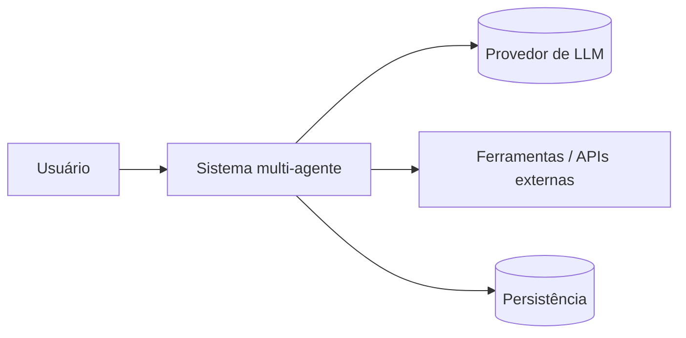

# Arquitetura

> Descreve o **estado atual**. Cada decisão estrutural aqui deve apontar para o ADR que a justifica.

## Visão geral (C4 — nível de contexto)

TODO(owner): substituir pelo diagrama real após os ADRs de stack.

## Containers / módulos

| Módulo | Responsabilidade | Depende de | ADR |
|--------|------------------|------------|-----|
| `orchestrator` | Recebe a tarefa, planeja e despacha para agentes | `agents`, `core` | TODO |
| `agents` | Agentes especializados (um diretório por agente) | `core`, `tools` | TODO |
| `tools` | Ferramentas que os agentes podem invocar | `core` | TODO |
| `core` | Domínio e regras de negócio puras, sem I/O | — | TODO |
| `infra` | Adaptadores: LLM, banco, filas, observabilidade | `core` | TODO |

## Regras de dependência (MUST)

- **ARC-001:** `core` não depende de nenhum outro módulo, nem de SDKs de LLM.
- **ARC-002:** Dependências apontam para dentro (`infra` → `core`, nunca o contrário). É uma arquitetura hexagonal.
- **ARC-003:** Agentes não chamam outros agentes diretamente. A comunicação passa pelo `orchestrator` ou pelo barramento definido em `07-agent-system.md`.
- **ARC-004:** Acesso a provedor de LLM somente via a porta `LLMClient` em `core` e o adaptador em `infra`.

## Atributos de qualidade

| Atributo | Meta | Como medimos |
|----------|------|--------------|
| Observabilidade | 100% das chamadas de LLM e ferramentas rastreadas | traces com `run_id` |
| Custo | TODO(owner) | tokens por tarefa |
| Latência | TODO(owner) | p95 por fluxo |
| Confiabilidade | TODO(owner) | taxa de sucesso nas evals |

## Stack

TODO(owner): definir linguagem, runtime, framework de agentes, banco e provedor de LLM. Cada escolha gera um ADR.
